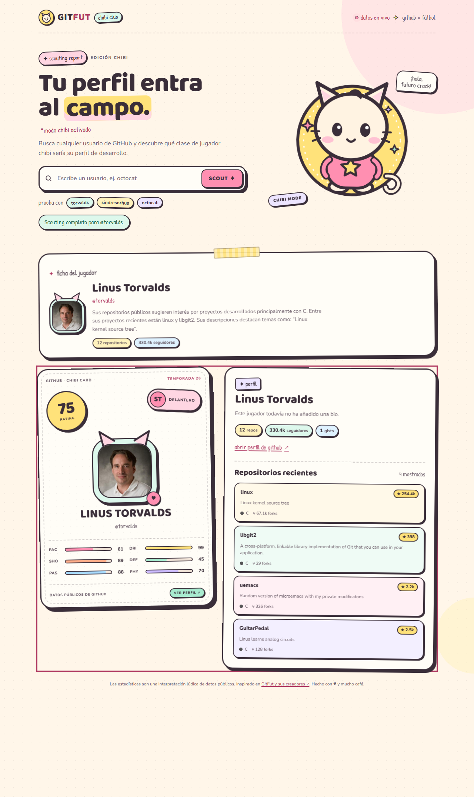

# 🐾 GitFut · Chibi Club

### ⚽ ¡Tu perfil de GitHub entra al campo… en versión chibi!

**GitFut Chibi Club** es una aplicación web interactiva que transforma cualquier perfil público de GitHub en una carta de jugador coleccionable, inspirada en los videojuegos de fútbol.

Mediante el consumo de la **API REST de GitHub**, analiza información pública del desarrollador y genera una ficha personalizada con estadísticas, valoración general (OVR), posición futbolística y sus repositorios más recientes.

Todo esto acompañado de una estética chibi original, colores pastel, animaciones y una interfaz adaptable a distintos dispositivos.



---

## ✨ Características principales

- 🔍 **Búsqueda de desarrolladores:** permite consultar cualquier perfil público de GitHub.
- 🐱 **Estética Chibi Club:** diseño original con papel crema, tinta, colores pastel, stickers y sombras pronunciadas.
- 🃏 **Carta coleccionable:** genera una tarjeta personalizada con avatar, rating, rol y estadísticas animadas.
- ⚽ **Posición futbolística:** asigna una posición según las estadísticas calculadas del perfil.
- 📦 **Repositorios recientes:** muestra los cuatro repositorios públicos actualizados más recientemente.
- 🎨 **Identificación visual:** utiliza colores asociados a lenguajes de programación y números compactos (`1.2k`, `330.4k`).
- ⏳ **Estados de carga:** incorpora skeletons y spinner durante las consultas.
- 🧯 **Manejo de errores:** identifica usuarios inexistentes, límites de la API y problemas de conexión.
- 📱 **Diseño responsive:** adaptable a computadores, tablets y dispositivos móviles.
- ♿ **Accesibilidad:** soporte para etiquetas ARIA y preferencias de movimiento reducido.
- ⚡ **Arquitectura ligera:** sin frameworks de JavaScript ni proceso de compilación.

---

## 🧠 ¿Cómo funciona?

El funcionamiento se divide en cinco etapas:

1. **Búsqueda:** el usuario introduce un nombre de usuario de GitHub o selecciona una sugerencia.
2. **Consulta del perfil:** la aplicación obtiene información pública mediante la API REST de GitHub.
3. **Obtención de repositorios:** consulta los cuatro repositorios públicos actualizados más recientemente.
4. **Procesamiento:** calcula seis estadísticas, un rating general y un rol futbolístico utilizando los datos obtenidos.
5. **Visualización:** genera una carta chibi y una ficha de scouting con la información del desarrollador.

### 🔄 Flujo de funcionamiento

```text
        ┌──────────────────────┐
        │   Usuario GitHub     │
        └──────────┬───────────┘
                   │
                   ▼
        ┌──────────────────────┐
        │ Búsqueda del perfil  │
        └──────────┬───────────┘
                   │
                   ▼
        ┌──────────────────────┐
        │   GitHub REST API    │
        └──────────┬───────────┘
                   │
          ┌────────┴────────┐
          ▼                 ▼
   Datos del perfil   Repositorios
          │                 │
          └────────┬────────┘
                   ▼
        ┌──────────────────────┐
        │ Cálculo de stats     │
        │ y rating general     │
        └──────────┬───────────┘
                   │
                   ▼
        ┌──────────────────────┐
        │ Carta Chibi Club     │
        │ y ficha de scouting  │
        └──────────────────────┘
```

> **Nota:** las estadísticas son una interpretación lúdica de los datos públicos de GitHub. No representan una evaluación profesional ni una medida objetiva de la calidad de un desarrollador.

---

## 📊 Sistema de estadísticas

GitFut Chibi Club utiliza seis atributos para representar diferentes aspectos de un perfil público.

| Stat | Nombre | Qué representa |
|---|---|---|
| **PAC** | Ritmo | Actividad y frecuencia de publicación |
| **DRI** | Regate | Impacto de forks y cantidad de repositorios |
| **SHO** | Tiro | Popularidad e impacto: estrellas y seguidores |
| **DEF** | Defensa | Comunidad que sigue y gists públicos |
| **PAS** | Pase | Alcance de la red de seguidores |
| **PHY** | Físico | Volumen de repositorios y estrellas |

Los valores están limitados al rango de **35 a 99 puntos**.

### 🏆 Rating general (OVR)

El rating general se calcula mediante el promedio redondeado de las seis estadísticas:

```text
OVR = ROUND((PAC + DRI + SHO + DEF + PAS + PHY) / 6)
```

Este valor se utiliza para representar el nivel de la carta dentro del sistema de juego.

### ⚽ Posiciones futbolísticas

La aplicación asigna una posición a partir de las estadísticas predominantes.

| Código | Posición | Condición aproximada |
|---|---|---|
| `ST` | Delantero | El atributo más alto es SHO |
| `CM` | Mediocampo | El atributo más alto es PAS |
| `DF` | Defensa | El atributo más alto es DEF |
| `GK` | Portero | Se utiliza en los demás casos |

La posición representa un arquetipo visual del desarrollador dentro de la experiencia.

---

## 🛠️ Tecnologías utilizadas

El proyecto está desarrollado con tecnologías web nativas, sin frameworks de JavaScript.

| Tecnología | Utilización |
|---|---|
| **HTML5** | Estructura semántica de la interfaz |
| **CSS3** | Estilos, animaciones y diseño responsive |
| **JavaScript Vanilla** | Lógica de búsqueda, cálculos y manipulación del DOM |
| **GitHub REST API** | Consulta de perfiles y repositorios públicos |
| **Google Fonts** | Tipografías Baloo 2, Nunito y Patrick Hand |

### Características técnicas

- Uso de `fetch()` para peticiones HTTP.
- Manipulación dinámica del DOM.
- Diseño mediante CSS Grid y Flexbox.
- Variables CSS personalizadas.
- Estados visuales para carga y errores.
- Compatibilidad con `prefers-reduced-motion`.
- Sin proceso de build ni dependencias instalables.

---

## 🚀 Instalación y ejecución

GitFut Chibi Club no requiere instalación de paquetes ni compilación.

### 1. Clonar el repositorio

```bash
git clone https://github.com/YurgenVelasco/Buscador_github.git
```

### 2. Acceder al directorio

```bash
cd Buscador_github
```

### 3. Ejecutar el proyecto

Puede abrir directamente el archivo `index.html` en su navegador.

También puede utilizar un servidor HTTP local.

**Opción A: Python**

```bash
python -m http.server 4173
```

**Opción B: Node.js**

```bash
npx serve .
```

Si utiliza Python, abra:

```text
http://localhost:4173
```

Con `npx serve .`, utilice la dirección local que aparezca en la terminal.

### Requisitos

- Navegador web moderno.
- Conexión a Internet para consultar GitHub.
- Python o Node.js únicamente si se desea utilizar un servidor local.

---

## 📁 Estructura del proyecto

```text
Buscador_github/
│
├── index.html
│
├── css/
│   └── styles.css
│
├── js/
│   └── app.js
│
├── assets/
│   └── preview.png
│
├── LICENSE
│
└── README.md
```

### Descripción de archivos

| Archivo | Función |
|---|---|
| `index.html` | Estructura principal y elementos visuales |
| `css/styles.css` | Diseño chibi, responsive y animaciones |
| `js/app.js` | Consultas a GitHub, estadísticas y estados |
| `assets/preview.png` | Captura de la interfaz |
| `LICENSE` | Condiciones de uso del código |
| `README.md` | Documentación del proyecto |

---

## 🌐 Integración con GitHub REST API

La aplicación utiliza información pública proporcionada por GitHub.

### Consultar un usuario

```http
GET https://api.github.com/users/{username}
```

### Consultar repositorios recientes

```http
GET https://api.github.com/users/{username}/repos?sort=updated&per_page=4
```

### Información utilizada

- Nombre de usuario.
- Avatar.
- Biografía y datos públicos del perfil.
- Número de seguidores.
- Cantidad de repositorios públicos.
- Estrellas y forks.
- Información de repositorios recientes.

### Límites de consulta

La API pública de GitHub permite generalmente **60 peticiones por hora por dirección IP** sin autenticación.

Cada búsqueda utiliza dos consultas principales. Si se alcanza el límite, la aplicación informa del problema.

Para información adicional consulte la [documentación oficial de GitHub REST API](https://docs.github.com/es/rest).

---

## ♿ Accesibilidad

La aplicación incorpora medidas para facilitar su uso en diferentes dispositivos y condiciones.

- HTML semántico.
- Etiquetas ARIA cuando aportan información relevante.
- Indicadores de estado mediante `role="status"` y `aria-live="polite"`.
- Gestión del foco al mostrar resultados.
- Adaptación a diferentes tamaños de pantalla.
- Compatibilidad con preferencias de movimiento reducido.
- Diseño orientado a mantener una lectura clara y un contraste adecuado.

### Auditoría Lighthouse

Resultados reportados para el proyecto:

| Categoría | Puntuación |
|---|---:|
| Accesibilidad | 100 |
| Buenas prácticas | 100 |
| SEO | 100 |

> Los resultados de Lighthouse corresponden a la versión y al entorno en que se realizó la auditoría. Pueden variar después de modificaciones o en otras condiciones de ejecución.

---

## 🛡️ Privacidad y consideraciones

- La aplicación consulta únicamente información pública de GitHub.
- No requiere contraseña ni inicio de sesión.
- No solicita acceso a repositorios privados.
- Los avatares y datos mostrados pertenecen a sus respectivos usuarios.
- Las estadísticas se utilizan únicamente con fines recreativos.
- La aplicación depende de la disponibilidad y los límites de GitHub REST API.

---

## 💡 Posibles mejoras futuras

El proyecto puede continuar evolucionando mediante nuevas funcionalidades:

- [ ] Comparación de cartas entre desarrolladores.
- [ ] Descarga de cartas como imágenes.
- [ ] Diferentes estilos y rarezas de cartas.
- [ ] Historial local de perfiles consultados.
- [ ] Compartir cartas mediante enlaces.
- [ ] Nuevas estadísticas y reconocimientos.
- [ ] Pruebas automatizadas de interfaz.
- [ ] Optimización de rendimiento y accesibilidad.

Estas funciones son propuestas de evolución y no forman parte necesariamente de la versión actual.

---

## 🤝 Contribuciones

Las contribuciones que aporten mejoras al proyecto son bienvenidas.

Puede participar reportando errores, proponiendo funcionalidades o enviando mejoras de código.

### Cómo contribuir

1. Realice un **fork** del repositorio.
2. Cree una rama para sus cambios.

```bash
git checkout -b feature/mi-mejora
```

3. Implemente y pruebe su modificación.
4. Registre los cambios.

```bash
git add .
git commit -m "feat: agregar mejora al proyecto"
```

5. Envíe su rama al repositorio remoto.

```bash
git push origin feature/mi-mejora
```

6. Abra un **Pull Request** explicando los cambios realizados.

Todas las contribuciones deben respetar la licencia del proyecto.

---

## 🙌 Créditos y agradecimientos

La idea de representar desarrolladores mediante cartas futbolísticas está inspirada en [GitFut](https://github.com/younesfdj/gitfut) y sus creadores.

**GitFut Chibi Club** presenta una identidad visual propia, con estética chibi, elementos gráficos originales y una implementación independiente para esta versión.

Agradecimientos a GitHub por proporcionar una API pública que facilita la creación de proyectos educativos y experimentales.

---

## 👨‍💻 Autor

**Yurgen Andrey Velasco Rojas**

Desarrollador de software en formación, enfocado principalmente en el desarrollo backend y la construcción de aplicaciones web.

Interesado en el ecosistema **C# / .NET**, bases de datos, arquitectura de software y desarrollo de soluciones tecnológicas.

**Perfil profesional:**

- GitHub: [@YurgenVelasco](https://github.com/YurgenVelasco)

---

## 📄 Licencia

Este proyecto se distribuye bajo la **Licencia MIT**.

Se permite su uso, modificación y distribución conforme a los términos establecidos en el archivo [LICENSE](LICENSE).

La licencia aplica al código original del proyecto y no modifica los derechos correspondientes a recursos de terceros.

---

### 🐾 GitFut · Chibi Club

**Donde los desarrolladores también tienen su propia carta de jugador.**

Hecho con ❤️, código y mucho café. ☕
